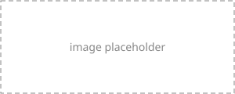

# Section 1.1 Title

<!-- TEMPLATE: this page shows the syntax of every interactive element.
     Replace each placeholder with your own content and delete what you don't use. -->

## Subheading

Paragraph text with a [link to another page](ch01-02-section-title.md).

> Note: Placeholder note text.

> Tip: Placeholder tip text.

> Warning: Placeholder warning text.

<Listing number="1-1" file-name="src/main.ts" caption="Placeholder caption">

```ts
function main(): void {
  // placeholder
}
```

</Listing>

```ts,runnable
const items = [3, 1, 2]; // @hide
const sorted = [...items].sort((a, b) => a - b);
console.log(sorted);
```

```js,runnable,editable
console.log("Readers can edit this and run it again.");
```

```ts,does_not_compile
const x: number = "not a number";
```

```ts,runnable,throws
JSON.parse("{ not json");
```

```ts,not_desired_behavior
const total = [1, 2, 3].reduce((sum, n) => sum - n, 0);
```

```ts
{{#include ../code/greet.ts}}
```

<figure>



<figcaption>Figure 1-1: Placeholder caption</figcaption>

</figure>

{{#quiz ../quizzes/ch01-01-section-title.toml}}
